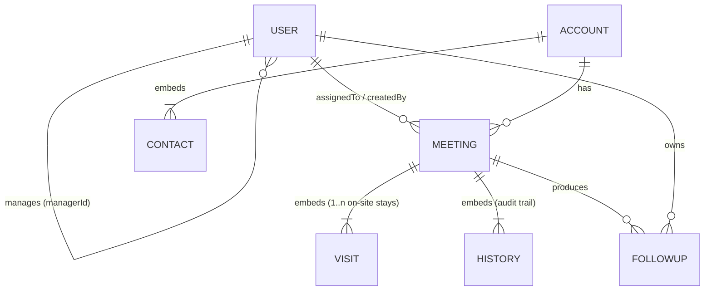

# Optronix – Sales Meeting & Visit Management (Backend)

Express + TypeScript + MongoDB (Mongoose) API. The Next.js frontend lives in `../frontend` (next phase).

## Quick start

```bash
cp .env.example .env          # edit MONGODB_URI / JWT_SECRET if needed
npm install
npm run seed                  # demo users + accounts (password for all: Password@123)
npm run dev                   # http://localhost:4000   (health: GET /health)
```

| Script | Purpose |
|---|---|
| `npm run dev` | Dev server with reload |
| `npm run build && npm start` | Compile to `dist/` and run |
| `npm run typecheck` | `tsc --noEmit` (src + tests) |

**Demo logins** (after `npm run seed`): `admin@optronix.test`, `manager1@optronix.test` (team: ravi, sana), `manager2@optronix.test` (team: tarun), `ravi@optronix.test`, `sana@optronix.test`, `tarun@optronix.test`.

## Architecture

```
src/
  domain/        constants.ts, meetingRules.ts   <- PURE business rules (no DB/HTTP/clock). Unit-tested.
  models/        User, Account(+contacts), Meeting(+visits, history), FollowUp
  services/      meetingService (lifecycle orchestration), followUpService, access (visibility), authService
  routes/        thin Express routers: parse -> call service -> serialise
  validators/    zod schemas for every request body/query
  middleware/    auth (JWT + role guard), validate, errorHandler
  utils/         AppError helpers, injectable clock
  scripts/       All scripts
```

Layering rule: **rules decide, services orchestrate, routes translate**. All rules take `now` as an argument and the
service reads time through `utils/clock.ts`, so the 10:02 / 15:10 scenario is reproduced deterministically in tests.

## Data model



* **User** `{name, email*, passwordHash, role: employee|manager|admin, managerId, isActive}`
* **Account** `{name, address, industry, contacts[{name, designation, email, phone}]}`
* **Meeting** `{accountId, contactId, contactName(snapshot), purpose, scheduledStart/End, location, assignedTo, createdBy, notes, status, onSite, nextVisitAt, visits[], totalOnSiteMs, outcome, outcomeNotes, completedAt, completionCount, reopenCount, rescheduleCount, cancelReason, history[]}`
* **Visit** (embedded) `{checkInAt, checkInLocation{lat,lng,accuracy}, expectedAt, lateMinutes, startedAt, checkOutAt, checkOutLocation, endReason: completed|return_later|unable_to_meet}`
* **History** (embedded, append-only) `{at, by, action, from, to, note, meta}`
* **FollowUp** `{meetingId, accountId, ownerId, createdBy, description, dueDate, status: open|done|cancelled, source: outcome|manual, completionNo}`

Visits and history are embedded (they never exist without the meeting and are always read with it), which also lets a
single-document atomic update change status + visit + history together. MongoDB is schemaless, so "migrations" are
Mongoose schemas plus `Meeting.syncIndexes()` on boot (and in `seed`). Indexes: `{assignedTo, scheduledStart}`,
`{status}`, `{ownerId,status,dueDate}` and the **partial unique** `{assignedTo}` where `onSite:true`.

## Meeting lifecycle

```
                    reschedule (back to scheduled)
              ┌───────────────────────────────┐
 Scheduled ──confirm──> Confirmed ──check-in──> Checked In ──start──> In Progress ──check-out(complete)──> Completed
     │                     │  ▲                     │                    │                                    │
     │ cancel              │  │ return check-in     │ check-out          │ check-out(return_later)            │ reopen
     ▼                     ▼  │                     │ (return_later)     ▼                                    │ (manager/admin)
 Cancelled <──cancel── On Hold <─────────────────────┴────────────────────┘ <──────────────────────────────────┘
```

Extra states beyond the brief: **On Hold** (= awaiting a return visit) and **Cancelled**.
Transitions are explicit commands (`/confirm`, `/check-in`, `/start`, `/check-out`, …), never a free-form status PATCH.

### The design scenario (10:02 check-in → leave 10:40 → return 15:10 → finish 16:00)

Modelled as **one meeting with two visits**:

1. 10:02 `check-in` → visit #1, `lateMinutes = 2` (vs. scheduled 10:00); `start` → In Progress.
2. 10:40 `check-out {disposition:"return_later", returnAt:15:00}` → visit #1 closed (`endReason: return_later`),
   meeting → **On Hold** with `nextVisitAt = 15:00`. No outcome is required yet, because the meeting is not finished.
3. 15:10 `check-in` → visit #2, lateness is measured against the **agreed 15:00**, not the original 10:00 slot (`lateMinutes = 10`).
4. 16:00 `check-out {disposition:"complete", outcome, followUp?}` → Completed. `totalOnSiteMinutes = 38 + 50 = 88`.

Why not a second meeting? The customer conversation is one business event: one outcome, one follow-up, one record
for reporting; splitting it would double-count meetings and lose the link. Why not "just pause"? Per-visit rows keep
honest evidence (GPS + timestamps for *each* stay) and make travel/idle time visible. Alternatives are discussed below.

## Business rules (enforced server-side)

| # | Rule | Error |
|---|---|---|
| 1 | Only the transitions in the state machine are allowed | 409 `INVALID_TRANSITION` |
| 2 | End > start, ≤ 8 h, not in the past (5 min grace) | 422 |
| 3 | No overlapping meetings for one employee (back-to-back is fine) | 422 `MEETING_OVERLAP` |
| 4 | Contact must belong to the account; assignee must be active sales staff | 422 |
| 5 | Check-in needs *Confirmed* (or *On Hold* for returns); opens 30 min before expected start; first visit refused >2 h after scheduled end (must reschedule) | 409 / 422 |
| 6 | An employee can be checked in to **one** meeting at a time (unique partial index = safe under concurrency) | 409 `ALREADY_CHECKED_IN` |
| 7 | Timestamps are server-side only; GPS lat/lng validated (captured, not geofenced) | 400 |
| 8 | Completing requires *In Progress* and an outcome. Only `unable_to_meet` may skip it (customer no-show), and not before the scheduled start | 409 / 422 |
| 9 | `follow_up_required` ⇒ follow-up with owner + future due date; owner ∈ {assignee, their manager, admin} | 422 |
| 10 | `return_later` needs a future `returnAt` (≤ 14 days) that doesn't collide with another meeting | 422 |
| 11 | Only the assignee can check in/start/check out (location evidence), even admins cannot act for them | 403 `NOT_ASSIGNEE` |
| 12 | Reopen: manager of the assignee or admin; reason required; managers limited to 30 days and **never their own meetings**; clears outcome, cancels that completion's outcome-follow-ups, history keeps the old outcome | 403 / 409 |
| 13 | Completed/cancelled meetings are read-only; scheduling fields change only via `/reschedule` (which resets to *Scheduled*) | 409 |

**Permissions.** Employee: own meetings. Manager: self + team (`managerId`). Admin: everything + user management.
Out-of-scope resources return **404** (not 403) so ids can't be probed. See `docs/API.md` for the endpoint matrix.

## Decisions & Trade-offs

**Assumptions**
* One customer conversation = one meeting, possibly several visits (see scenario above).
* "Location" at check-in/out is GPS lat/lng + accuracy supplied by the device; no geofence yet (customer coordinates aren't modelled).
* A manager manages employees directly (one level). Managers can also run their own meetings.
* Admins administer and oversee; they are not assignable to meetings.

**Shortcuts taken**
* **No multi-document transactions** (per your choice: standalone MongoDB). State changes use compare-and-set
  `findOneAndUpdate({_id, status})` → `409 STALE_STATE` on races. Completion + follow-up creation spans two collections,
  so it does *create follow-up → update meeting → delete follow-up on failure* (compensation). A crash between steps
  could leave an orphan follow-up; with a replica set I would wrap this in a transaction (or embed follow-ups).
* Overlap check is check-then-insert (not race-proof, unlike the one-active-visit rule which is index-backed).
* GPS is trusted from the client (spoofable). No rate limiting, refresh tokens, password reset or email verification.
* Pagination is offset-based; no full-text search; account/contact management is minimal.
* Time zones: all instants are UTC ISO-8601; "tomorrow 10:00" semantics are the client's responsibility.

**For production I would**
* Run a replica set + transactions; add an outbox/notification job for due/overdue follow-ups and no-show detection
  (meetings never visited past their window → auto `unable_to_meet`/flag for the manager).
* Add geofencing (account coordinates + radius, soft-warn vs. hard-block), offline check-in queue with *client time + server receive time*, and anomaly flags (impossible travel).
* Short-lived access + refresh tokens, RBAC as data (permissions table), audit log in its own collection, structured logging, OpenAPI generated from the zod schemas, CI with the test suite, and soft-delete/retention policy.
* Reassignment workflow, recurring meetings, calendar sync, and reporting (time on site, lateness, outcome funnel).

**Alternatives considered for the scenario:** (a) *pause/resume* on one visit – simpler but loses per-stay GPS evidence and
makes lateness meaningless; (b) *close + create linked meeting* – clean per-meeting data but double-counts meetings and
forces an artificial outcome ("unable to meet") for a conversation that actually happened.
